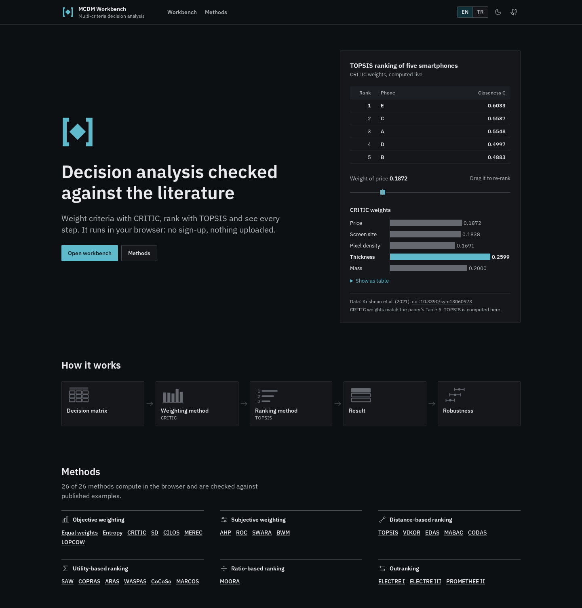
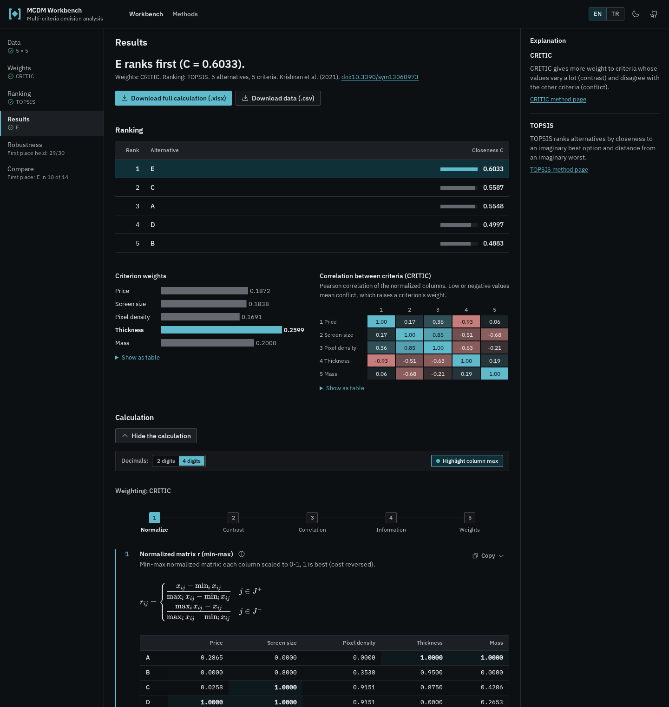
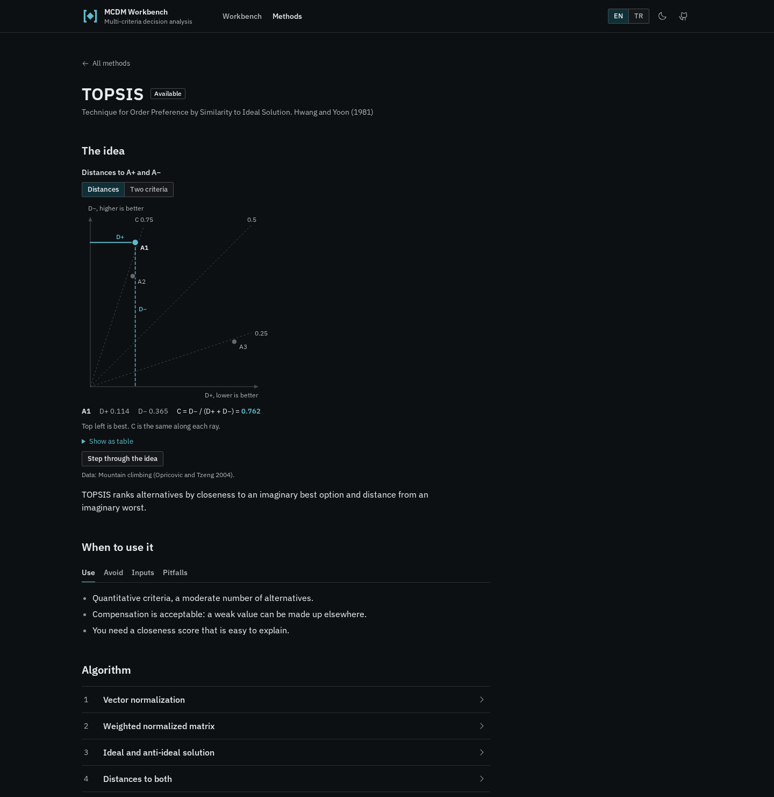

<h1>
  <picture>
    <source media="(prefers-color-scheme: dark)" srcset="docs/brand/lockup-horizontal-dark.svg">
    
  </picture>
</h1>

A browser tool for multi-criteria decision analysis: weight criteria with CRITIC, Entropy, SD or MEREC, rank alternatives with TOPSIS, SAW, VIKOR or EDAS and read every intermediate step, in English or Turkish.

**Live demo:** https://fatihaydost.github.io/kds-topsis-critic/



## What it does

- Enter a decision matrix in a spreadsheet-like grid, paste it from Excel or import `.xlsx` / `.csv`, and mark each criterion as benefit or cost.
- Weights from CRITIC, Entropy (raw-data shares or min-max), SD (standard deviation of the min-max columns), MEREC (removal effect of each criterion, positive data only), equal weights or your own; ranking by TOPSIS (closeness C), SAW (weighted sum S, linear max or sum normalization, with each score drawn as its criteria's contributions) or VIKOR (compromise index Q with a v slider, group utility S against the largest regret R, the acceptable advantage and stability conditions and the compromise set) or EDAS (appraisal score AS from the weighted distance above and below the average solution, drawn as one diverging bar per alternative).
- Shows the worked calculation step by step, with formulas and labelled matrices; copy any step as TSV or LaTeX, or download the whole calculation as `.xlsx`.
- Runs entirely in the browser: no sign-up, no server, nothing uploaded.



## Verified against the literature

The test suite recomputes published examples and compares every printed digit:

| Method | Reference | What is compared | Tolerance |
|---|---|---|---|
| CRITIC | Krishnan et al. (2021), Symmetry 13(6):973, Tables 1, 2 and 5 | standard deviations and weights | ±0.00005 |
| Entropy | Zavadskas et al. (2017), Sustainability 9(5):702, Tables 4 and 8 (the paper prints the weights on permuted rows); min-max option: Krishnan et al. (2021), Tables 1, 2 and 5 | weights (min-max: also the normalized matrix) | ±0.0001 (min-max ±0.00005) |
| SD | Diakoulaki et al. (1995), Computers & OR 22(7):763, Table 1, Section 5 and Table 3 (the printed σ is the population SD); Mukhametzyanov (2021), DMAME 4(2):76, Tables 1, 2 and 4, four matrices with cost criteria | weights and standard deviations | ±0.0005 |
| MEREC | Keshavarz-Ghorabaee et al. (2021), Symmetry 13(4):525, Tables 2-4 and Steps 3-6 (illustrative) and Tables 5-6 (comparative); Dua et al. (2024), EUREKA: Physics and Engineering (2):131, Tables 8-9 and 12-13 | weights, normalized matrix, S, S′ and removal effects | ±0.00005 (comparative ±0.0005; S, S′, E ±0.005) |
| TOPSIS | Opricovic and Tzeng (2004), EJOR 156(2):445, Table 3, two unit variants | D+, D−, closeness and ranks | ±0.0005 |
| SAW | Podvezko (2011), Engineering Economics 22(2):134, Tables 1-3 (linear max; Table 2 misprints one Lithuania value, Table 3 follows the misprint) and 5-6 (sum); ranks of Keshavarz Ghorabaee et al. (2015) Table 7, Zavadskas et al. (2012) Table 2 and Vujičić et al. (2017) Tables 8a-8b | normalized matrices, scores and ranks | ±0.0005 |
| VIKOR | Opricovic and Tzeng (2004), EJOR 156(2):445, Table 3, two unit variants; ranks of Keshavarz Ghorabaee et al. (2015) Table 7, all seven weight sets (v = 0.5) | S, R, Q, ranks, C1, C2 and the compromise | ±0.0005 |
| EDAS | Keshavarz Ghorabaee et al. (2015), Informatica 26(3):435, Tables 1-3 (47 items; Table 2 is rounded to 3 and then 2 decimals, all 517 cells reproduced) and Table 7 (ranks, all seven weight sets); Aydın Ünal (2019) and Sarıhan and Aydın (2023), each with a printing error recorded | average, PDA, NDA, SP, SN, NSP, NSN, AS, classes and ranks | ±0.006 |

CRITIC is also checked against the hand-solved spreadsheet from the original coursework (`legacy/CRITIC(2).xlsx`) and the full CRITIC + TOPSIS chain against the legacy Python code, both to 10⁻¹². Fixtures are in [`tests/fixtures/`](tests/fixtures).

## Methods

9 methods compute today (CRITIC, Entropy, SD, MEREC, equal weights, TOPSIS, SAW, VIKOR, EDAS) and 17 more are researched and documented, each with its own page: [methods catalogue](https://fatihaydost.github.io/kds-topsis-critic/methods).



## Tech

React 19, TypeScript, Vite, Tailwind CSS 4, Radix UI, KaTeX, SheetJS, i18next; Vitest and Playwright; static build on GitHub Pages.

## Run locally

Needs Node 24 or newer and pnpm.

```sh
pnpm i
pnpm dev      # http://localhost:5173
pnpm test     # unit tests
pnpm e2e      # Playwright end-to-end tests
```

## Docs

- [Design notes](docs/design/DESIGN.md)
- [Method research](docs/research/)

## Project history

Started as a Flask coursework app for CRITIC and TOPSIS; that version is kept unchanged in [`legacy/`](legacy).

## License

[MIT](LICENSE)
