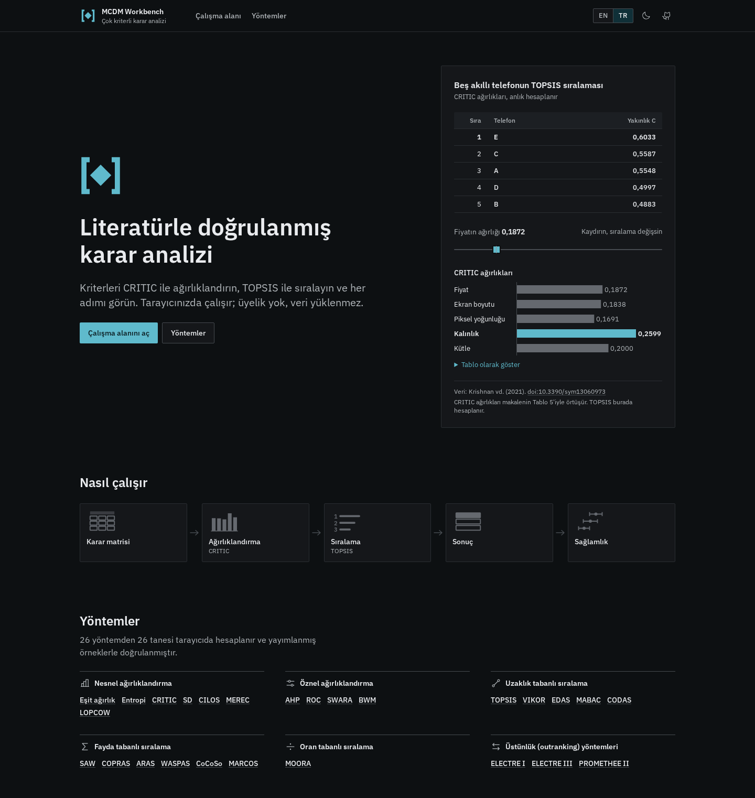
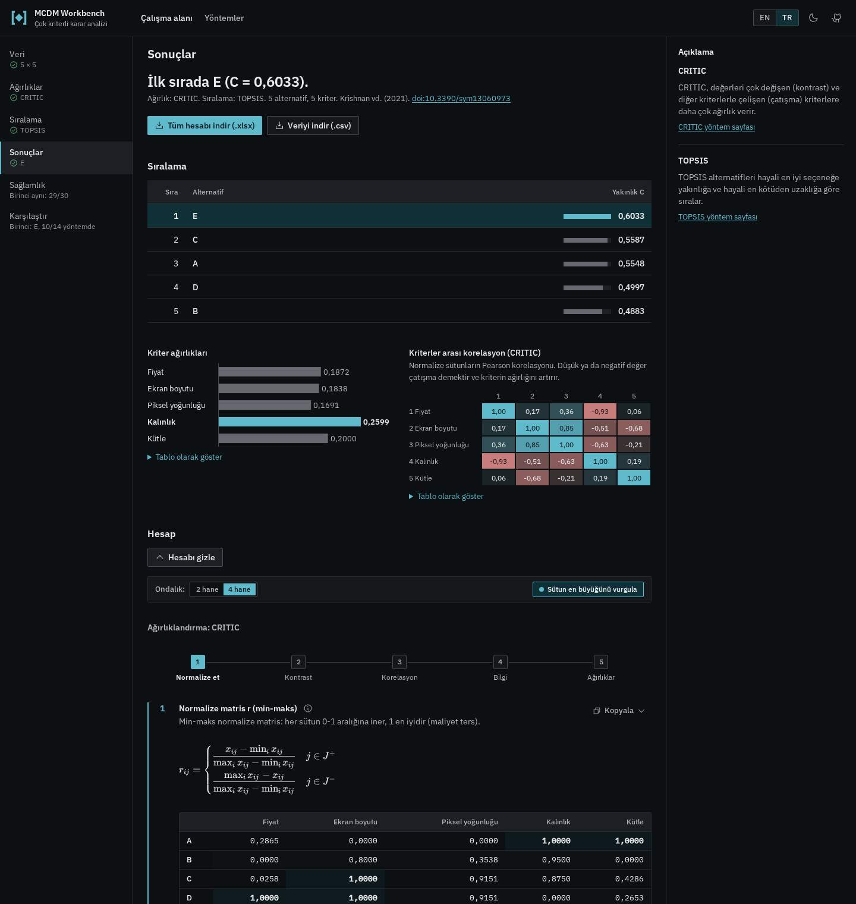
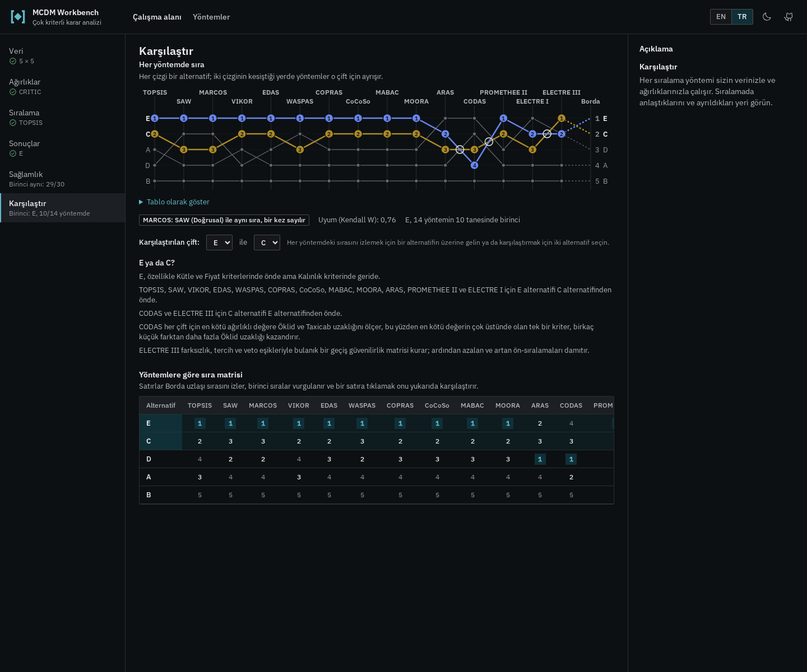
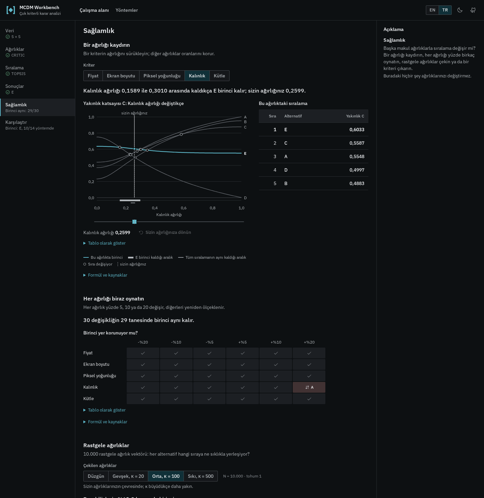
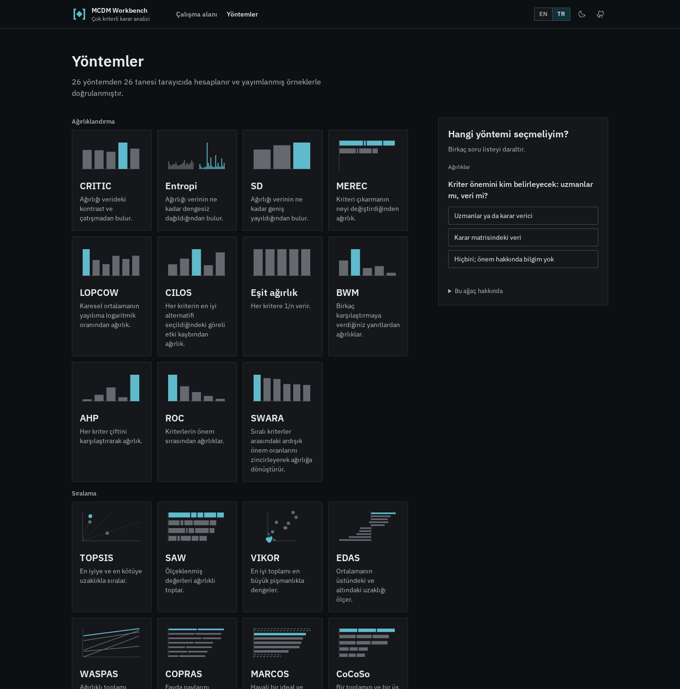
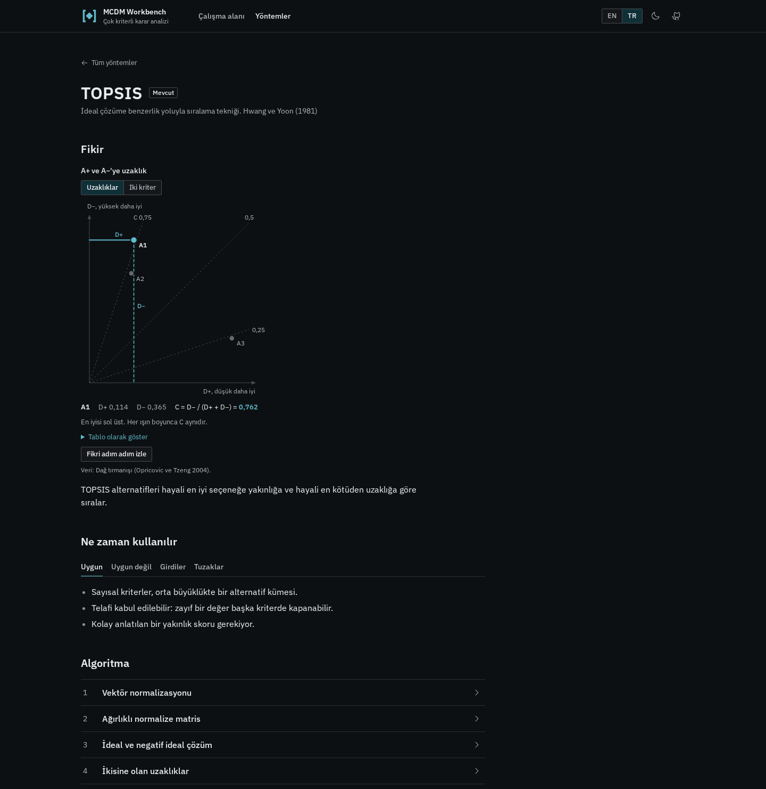

<h1>
  <picture>
    <source media="(prefers-color-scheme: dark)" srcset="docs/brand/lockup-horizontal-dark.svg">
    
  </picture>
</h1>

<p>
  <a href="README.md">English</a> · <strong>Türkçe</strong>
  &nbsp;|&nbsp;
  <strong>Canlı uygulama:</strong> <a href="https://fatihaydost.github.io/MCDM-Workbench/">fatihaydost.github.io/MCDM-Workbench</a>
  &nbsp;|&nbsp;
  <strong>Yöntem kataloğu:</strong> <a href="https://fatihaydost.github.io/MCDM-Workbench/methods">/methods</a>
</p>

Tarayıcıda çalışan **çok kriterli karar analizi (ÇKKV / MCDM / MCDA)** çalışma alanı: kriterlerinizi **11 nesnel ve öznel yöntemle** (CRITIC, Entropi, SD, MEREC, LOPCOW, CILOS, Eşit ağırlık, BWM, AHP, ROC, SWARA ya da kendi ağırlıklarınızla) ağırlıklandırın, alternatifleri **15 sıralama yöntemiyle** (TOPSIS, SAW, VIKOR, EDAS, WASPAS, COPRAS, MARCOS, CoCoSo, MABAC, MOORA, ARAS, CODAS, PROMETHEE II, ELECTRE I, ELECTRE III) sıralayın, ağırlık taraması ve Monte Carlo benzetimiyle sağlamlığı sınayın, tüm yöntemleri yan yana karşılaştırın ve her ara adımı **Türkçe** veya **İngilizce** olarak inceleyin.



## Neler yapar

- **1. Veri:** Karar matrisini hesap tablosu ızgarasına girin, doğrudan Excel'den yapıştırın, `.xlsx` / `.csv` dosyası içe aktarın ya da literatürdeki 25 referans örnekten birini yükleyin. Her kriteri fayda (`↑`) veya maliyet (`↓`) olarak işaretleyin.
- **2. Ağırlıklar (11 yöntem + elle giriş):** Veriden nesnel ağırlık hesaplayın (**CRITIC**, **Entropi**, **SD**, **MEREC**, **LOPCOW**, **CILOS**, **Eşit ağırlık**), uzman karşılaştırmalarından öznel ağırlık türetin (**BWM**, **AHP**, **ROC / RS / RR**, **SWARA**) ya da ağırlıkları doğrudan kendiniz girin.
- **3. Sıralama (15 yöntem):** Alternatifleri uzaklık tabanlı (**TOPSIS**, **VIKOR**, **EDAS**, **MABAC**, **CODAS**), fayda tabanlı (**SAW**, **COPRAS**, **ARAS**, **WASPAS**, **CoCoSo**, **MARCOS**), oran tabanlı (**MOORA**) veya üstünlük / outranking (**PROMETHEE II**, **ELECTRE I**, **ELECTRE III**) yöntemleriyle sıralayın; her yöntemin kendi verinizle çizilen etkileşimli geometrik grafiğini inceleyin.
- **4. Sonuçlar ve adım adım hesap:** Nihai sıralamayı, kriter ağırlıklarını, kriterler arası korelasyon ısı haritasını ve KaTeX formülleriyle etiketlenmiş tüm ara matrisleri adım adım görün. İstediğiniz adımı **TSV** veya **LaTeX** olarak kopyalayın ya da tüm hesabı çok sayfalı `.xlsx` veya `.csv` olarak indirin.
- **5. Sağlamlık ve duyarlılık analizi:** Herhangi bir kriterin ağırlığını `0` ile `1` arasında tarayarak sıra değişim noktalarını görün, ağırlıkları birlikte oynatın (`±%5`, `±%10`, `±%20`), **1.000 denemeli Dirichlet Monte Carlo** benzetimiyle sıra kabul edilebilirlik olasılıklarını hesaplayın ve kriter çıkarma (leave-one-out) testini arka planda Web Worker ile çalıştırın.
- **6. Çoklu yöntem karşılaştırma:** Uyumlu tüm sıralama yöntemlerini aynı veri ve ağırlıklarla aynı anda çalıştırın; **Spearman ρ** ve **Kendall τ** sıra korelasyonlarını, **Kendall W** uyum katsayısını, Borda uzlaşı sırasını ve iki yöntemin bir alternatif çiftinde neden ayrıştığını görün.
- **%100 tarayıcı içi ve gizli:** Üyelik yok, sunucu yok, veri gönderimi yok; verileriniz tarayıcınızdan dışarı çıkmaz.



### Çoklu yöntem karşılaştırma ve sağlamlık

15 sıralama yönteminin alternatiflerinizi nasıl dizdiğini, sıra çizgilerinin nerede kesiştiğini ve iki yöntemin neden farklı karar verdiğini yan yana inceleyin:



Birinci sıradaki alternatifin ağırlık değişimlerine, rastgele Monte Carlo ağırlık örneklemelerine ve kriter çıkarılmasına karşı ne kadar dayanıklı olduğunu sınayın:



## Yöntemler (26 / 26)

**26 yöntemin tamamı** tarayıcıda hesaplanır ve [`/methods`](https://fatihaydost.github.io/MCDM-Workbench/methods) sayfasında etkileşimli adım adım görselleştirme, formüller, tuzaklar, birlikte kullanıldığı yöntemler ve yöntem seçimi karar ağacıyla yer alır:

| Aile | Yöntem | Köken | Ne hesaplar |
|---|---|---|---|
| **Nesnel ağırlıklandırma** | **CRITIC** | Diakoulaki vd. (1995) | Min-maks kontrastı ($\sigma_j$) ile kriterler arası çatışmanın $\sum_k (1 - r_{jk})$ çarpımından ağırlık |
| **Nesnel ağırlıklandırma** | **Entropi** | Shannon (1948) / Zeleny (1982) | Shannon entropisi çeşitlenme derecesinden ($1 - e_j$) ağırlık (toplam payları veya min-maks) |
| **Nesnel ağırlıklandırma** | **SD** | Diakoulaki vd. (1995) | Min-maks normalize sütunların örneklem standart sapmasıyla orantılı ağırlık |
| **Nesnel ağırlıklandırma** | **MEREC** | Keshavarz-Ghorabaee vd. (2021) | Her kriter çıkarıldığında alternatiflerin logaritmik performans düşüşünden ağırlık |
| **Nesnel ağırlıklandırma** | **LOPCOW** | Ecer ve Pamucar (2022) | Karesel ortalamanın (RMS) örneklem standart sapmasına logaritmik oranından ağırlık |
| **Nesnel ağırlıklandırma** | **CILOS** | Zavadskas ve Podvezko (2016) | Göreli etki kaybı homojen doğrusal sistemini ($F w = 0$) çözen ağırlık |
| **Nesnel ağırlıklandırma** | **Eşit ağırlık** | Laplace | Her kritere $w_j = 1 / n$ veren temel referans ağırlık |
| **Öznel ağırlıklandırma** | **BWM** | Rezaei (2015, 2016) | En iyi ve en kötü kriterle yapılan $2n - 3$ karşılaştırmadan kapalı biçimli doğrusal BWM ağırlıkları ve CR |
| **Öznel ağırlıklandırma** | **AHP** | Saaty (1977, 1980) | İkili karşılaştırma matrisinden temel özvektör ve geometrik ortalama ağırlıkları ile Saaty CR kontrolü |
| **Öznel ağırlıklandırma** | **ROC** | Barron ve Barrett (1996) | Kriter önem sırasından sayısal ağırlıklar (ROC ağırlık merkezi, Sıra Toplamı RS, Ters Sıra RR) |
| **Öznel ağırlıklandırma** | **SWARA** | Keršulienė vd. (2010) | Sıralı kriterler arasındaki ardışık önem oranlarını ($k_j = 1 + s_j$) zincirleyerek ağırlık |
| **Uzaklık tabanlı sıralama** | **TOPSIS** | Hwang ve Yoon (1981) | Öklid ideal ve negatif-ideal çözümlerine göreli yakınlık $C_i = D_i^- / (D_i^+ + D_i^-)$ |
| **Uzaklık tabanlı sıralama** | **VIKOR** | Opricovic (1998) | Grup faydası $S_i$ ile bireysel pişmanlığı $R_i$ dengeleyen uzlaşı indeksi $Q_i$ ve $C_1, C_2$ koşulları |
| **Uzaklık tabanlı sıralama** | **EDAS** | Keshavarz Ghorabaee vd. (2015) | Ortalama çözümden ağırlıklı pozitif ($PDA$) ve negatif ($NDA$) uzaklıklarla değerlendirme skoru |
| **Uzaklık tabanlı sıralama** | **MABAC** | Pamučar ve Ćirović (2015) | Geometrik ortalama sınır yaklaşım alanına ($G_j$) işaretli uzaklıkların toplamı $S_i$ |
| **Uzaklık tabanlı sıralama** | **CODAS** | Keshavarz Ghorabaee vd. (2016) | Negatif-ideal çözüme Öklid uzaklığı $E_i$ ve $\tau$ eşikli Taxicab uzaklığı $T_i$ ile ikili değerlendirme |
| **Fayda tabanlı sıralama** | **SAW** | Churchman ve Ackoff (1954) | Doğrusal maks veya sütun toplamı normalizasyonu altında ağırlıklı toplam $S_i$ |
| **Fayda tabanlı sıralama** | **WASPAS** | Zavadskas vd. (2012) | Ağırlıklı toplam ($Q^{(1)}$) ile ağırlıklı çarpımın ($Q^{(2)}$) $\lambda$ karışımı ve $\lambda$ duyarlılık eğrisi |
| **Fayda tabanlı sıralama** | **COPRAS** | Zavadskas vd. (1994) | Fayda payı $S_i^+$ artı düşük maliyet payı bonusu $S_i^-$ ile göreli önem $Q_i$ ve fayda derecesi $N_i$ |
| **Fayda tabanlı sıralama** | **MARCOS** | Stević vd. (2020) | Genişletilmiş ideal ($AI$) ve anti-ideal ($AAI$) satırlara göre birleşik fayda fonksiyonu $f(K_i)$ |
| **Fayda tabanlı sıralama** | **CoCoSo** | Yazdani vd. (2019) | Ağırlıklı toplam $S_i$ ve üs toplamı $P_i$ değerlerinin üç uzlaşı okumasıyla ($k_{ia}, k_{ib}, k_{ic}$) birleşik puan $k_i$ |
| **Fayda tabanlı sıralama** | **ARAS** | Zavadskas ve Turskis (2010) | Optimal alternatif satırı $A_0$ ile oranlanan optimalite derecesi $K_i = S_i / S_0$ |
| **Oran tabanlı sıralama** | **MOORA** | Brauers ve Zavadskas (2006) | Vektör normalizasyonu sonrası ağırlıklı fayda toplamı eksi maliyet toplamı $y_i = S_i^+ - S_i^-$ |
| **Üstünlük (outranking)** | **PROMETHEE II** | Brans ve Vincke (1985) | Tek kriterli tercih fonksiyonları (Doğrusal, Olağan, Seviye, Gauss) ve net üstünlük akışı $\phi$ |
| **Üstünlük (outranking)** | **ELECTRE I** | Roy (1968) | Uyum çoğunluğu $C \ge \hat{c}$, uyumsuzluk vetosu $D \le \hat{d}$, döngü daraltma ve üstünlük çekirdeği |
| **Üstünlük (outranking)** | **ELECTRE III** | Roy (1978) | Sözde kriter eşikleri ($q, p, v$), bulanık güvenilirlik matrisi $\sigma(a,b)$ ile azalan ve artan damıtma |





## Literatürle doğrulama

Otomatik test takımı (**57 test dosyası, 1.732 birim testi**) hakemli makalelerdeki yayımlanmış örnekleri yeniden hesaplar ve basılı her basamağı karşılaştırır:

| Yöntem | Referans | Karşılaştırılan büyüklükler | Tolerans |
|---|---|---|---|
| CRITIC | Krishnan vd. (2021), *Symmetry* 13(6):973, Tablo 1, 2 ve 5 | standart sapmalar ve ağırlıklar | ±0,00005 |
| Entropi | Zavadskas vd. (2017), *Sustainability* 9(5):702, Tablo 4 ve 8 (makalede satır etiketleri yer değiştirmiştir); min-maks seçeneği: Krishnan vd. (2021), Tablo 1, 2 ve 5 | ağırlıklar (min-maks: ayrıca normalize matris) | ±0,0001 (min-maks ±0,00005) |
| SD | Diakoulaki vd. (1995), *Computers & OR* 22(7):763, Tablo 1, Bölüm 5 ve Tablo 3 (basılı σ anakütle standart sapmasıdır); Mukhametzyanov (2021), *DMAME* 4(2):76, Tablo 1, 2 ve 4 | ağırlıklar ve standart sapmalar | ±0,0005 |
| MEREC | Keshavarz-Ghorabaee vd. (2021), *Symmetry* 13(4):525, Tablo 2-4, Adım 3-6 ve Tablo 5-6; Dua vd. (2024), *EUREKA: Physics and Engineering* (2):131, Tablo 8-9 ve 12-13 | ağırlıklar, normalize matris, S, S′ ve çıkarma etkileri E | ±0,00005 (karşılaştırmalı ±0,0005; S, S′, E ±0,005) |
| LOPCOW | Ecer ve Pamucar (2022), *Omega* 112:102690; Keleş (2023), *ÖHÜ İİBF Dergisi* 16(3):727, Tablo 6-8 (10 lojistik firması, 8 kriter) | normalize matris, RMS, örneklem SD, PV ve ağırlıklar; RMS >= σ özdeşliği ve m = 2 durumu | ±0,0005 |
| CILOS | Zavadskas ve Podvezko (2016), *IJITDM* 15(2):267; Zavadskas vd. (2017), *Sustainability* 9(5):702, Tablo 4, 8 ve 10; Pala (2021), *Bingöl Üniv. İİBF Dergisi* 5(2):277 | toplam-normalize matris, kare matris A, göreli kayıp matrisi P, sistem matrisi F ve ağırlıklar | ±0,00005 |
| ROC | Barron ve Barrett (1996), *Management Science* 42(11):1515; Stillwell, Seaver ve Edwards (1981), *OBHP* 28(1):62; Roszkowska (2013), *Optimum. Studia Ekonomiczne* 5(65):14, Tablo 4 ve 5-6 | ROC, Sıra Toplamı (RS) ve Ters Sıra (RR) ağırlıkları ile eşit sıra ortalamalı ağırlıklar | ±0,00006 |
| SWARA | Keršulienė, Zavadskas ve Turskis (2010), *Journal of Business Economics and Management* 11(2):243, Tablo 1 (6 uyuşmazlık çözümü kriteri); Adalı ve Işık (2017), *IREM* 5(4):56, Tablo 5 | göreceli önem oranları s_j, adım katsayıları k_j = 1 + s_j, yeniden hesaplanan ağırlıklar q_j ve normalize ağırlıklar w_j | ±0,005 |
| BWM | Rezaei (2016), *Omega* 64:126, Örnek 1-3 (Örnek 3: Liang vd. (2020), Tablo 1); Ratandhara ve Kumar, *arXiv* 2506.17666, Örnek 1-4; Demir ve Bircan (2020), Tablo 5-7; Arsu ve Uğuz Arsu (2021), Tablo 4-5 | doğrusal model ağırlıkları, ξ, girdi tabanlı CR ve en az uyan kriter | ±0,00006 |
| AHP | Saaty (2008), *IJSSci* 1(1):83, Tablo 2, 7 ve 8; Doğuç (2022), *Beykent Üniv. Fen ve Müh. Bil. Dergisi* 15(1):19, Tablo 2; Bozóki, Fülöp ve Rónyai (2010), *EJOR* 206(2):355, Bölüm 6 (eksik 8×8 matris, LLSM tamamlama) | temel özvektör ve geometrik ortalama ağırlıkları, λ_maks, CI, CR, en çok ayrışan çift ve LLSM ağırlıkları | ±0,0005 |
| TOPSIS | Opricovic ve Tzeng (2004), *EJOR* 156(2):445, Tablo 3, iki birim varyantı | D+, D−, yakınlık katsayısı C ve sıralar | ±0,0005 |
| SAW | Podvezko (2011), *Engineering Economics* 22(2):134, Tablo 1-3 (doğrusal maks) ve 5-6 (toplam); Keshavarz Ghorabaee vd. (2015) Tablo 7, Zavadskas vd. (2012) Tablo 2 ve Vujičić vd. (2017) Tablo 8a-8b sıraları | normalize matrisler, skorlar ve sıralar | ±0,0005 |
| VIKOR | Opricovic ve Tzeng (2004), *EJOR* 156(2):445, Tablo 3, iki birim varyantı; Keshavarz Ghorabaee vd. (2015) Tablo 7, yedi ağırlık kümesi (v = 0,5) | S, R, Q, sıralar, C1, C2 ve uzlaşık küme | ±0,0005 |
| EDAS | Keshavarz Ghorabaee vd. (2015), *Informatica* 26(3):435, Tablo 1-3 (47 öğe, Tablo 2'deki 517 hücrenin tamamı) ve Tablo 7; Aydın Ünal (2019) ve Sarıhan ve Aydın (2023) | ortalama, PDA, NDA, SP, SN, NSP, NSN, AS, sınıflar ve sıralar | ±0,006 |
| WASPAS | Aytaç Adalı ve Tuş Işık (2017), *IREM* 5(4):56, Tablo 4-7 (tedarikçi seçimi, Tablo 7'nin tüm λ değerlerindeki 55 skoru); Chakraborty ve Zavadskas (2014), *Informatica* 25(1):1, Tablo 13-15; Zavadskas vd. (2012) Tablo 2 | normalize matris, WSM, WPM, her λ değerinde Q ve sıralar | ±0,0001 |
| COPRAS | Özcan ve Çelik (2021), *IJPME* 9(2):81, Tablo 1, 2, 10, 11 (krema separatörleri, Entropi + COPRAS); Podvezko (2011) Tablo 7-8; Zavadskas vd. (2007) Tablo 1-2 | ağırlıklı paylar, S+, S-, Q, N ve sıralar | ±0,0001 |
| MARCOS | Stević ve Brković (2020), *Logistics* 4(1):4, Tablo 2-5 (23 sürücü, FUCOM ağırlıkları); Madenoğlu (2020), *EBOR* 2(2):99, Tablo 3-7 (6 tedarikçi, 16 kriter, AHP ağırlıkları) | S, K-, f(K), referans toplamları ve sıralar; 300 rastgele problemde f(K) = c × SAW (doğrusal maks) | ±0,001 |
| CoCoSo | Yazdani vd. (2019), *Management Decision* 57(9):2501, Tablo I, III-VI (7 lojistik sağlayıcı) ve Tablo X-XI (10 yeşil tedarikçi); Akgül (2021), *Ekonomi ve Finansal Araştırmalar Dergisi* 3(2):71, Tablo 4-12 (9 banka, CRITIC ağırlıkları) | S, P, ka, kb, kc, k, sıralar ve λ sıra değişimleri; 200 rastgele problemde kaydırma ve ölçek değişmezliği | ±0,0015 |
| MABAC | Pamučar ve Ćirović (2015), *Expert Systems with Applications* 42(6):3016, Tablo 5, 7-12 (7 forklift, 10 kriter); Biswas ve Das (2018), *Management Science Letters* 8:121, Tablo 2-7; Çelik (2020), *İslam Ekonomisi ve Finansı Dergisi* 6(2):311, Tablo 3-12 | G, Q, S ve sıralar; 300 rastgele problemde S = min-maks ağırlıklı toplam - B; 500 alternatifte taşmama | ±0,0001 |
| MOORA | Brauers ve Zavadskas (2010), *TEDE* 16(1):5, Ek C Tablo 2 (6 proje, 9 kriter); Brauers ve Zavadskas (2006), *Control and Cybernetics* 35(2):445, Tablo 1 ve 5; Vujičić vd. (2017), *Tehnički vjesnik* 24(2):619, Tablo 1, 7 ve 8a-8b | vektör-normalize matris, ağırlıklı matris, S+, S-, y ve sıralar | ±0,0002 |
| ARAS | Zavadskas ve Turskis (2010), *TEDE* 16(2):159, Tablo 1-4 (14 oda, 6 kriter); Bakır ve Atalık (2018), *Business and Economics Research Journal* 9(1):179, Tablo 3-6 (11 havayolu, 8 kriter, Entropi ağırlıkları) | optimal satır, normalize ve ağırlıklı matrisler, S0, Si, fayda derecesi Ki ve sıralar | ±0,0001 |
| CODAS | Keshavarz Ghorabaee vd. (2016), *ECCSR* 50(3):25, Örnek 1-2 (7 robot ve 14 oda); Badi vd. (2018), *DMAME* 1(1):1, Tablo 2-5 (6 çelik tedarikçisi, AHP ağırlıkları); Trung (2022), *EUREKA: Physics and Engineering* (5):112, Tablo 12 ve 14-16 | normalize ve ağırlıklı matrisler, negatif-ideal çözüm, Öklid Ei, Taxicab Ti, göreli değerlendirme matrisi ve Hi | ±0,0005 |
| PROMETHEE II | Brans, Vincke ve Mareschal (1986), *EJOR* 24(2):228, Tablo 2-4 (6 hidroelektrik santrali, 6 tercih fonksiyonu tipi); Goswami (2020), *Foundations of Management* 12(1):93, Tablo 4, 7, 13-18 (6 dizüstü bilgisayar); Abdullah, Chan ve Afshari (2019), *IEEE Access* 7:43472, Tablo 5 ve 9-12 | toplam tercih matrisi Π, pozitif akış φ+, negatif akış φ−, net akış φ ve PROMETHEE I karşılaştırılamazlıkları | ±0,00001 |
| ELECTRE I | Roy (1968), *RIRO* 2(V1):57; Wang ve Triantaphyllou (2008), *Omega* 36(1):45, Bölüm 3.1 (Galway atıksu arıtma tesisi, 5 aday alan, 7 kriter); Soner ve Önüt (2006), *Gazi Üniv. Müh. Mim. Fak. Der.* 21(3):579 | uyum C, uyumsuzluk D, üstünlük grafı S, SCC döngü daraltmalı çekirdek K = {A2, A3, A5} ve net uyum / uyumsuzluk | ±0,0005 |
| ELECTRE III | Roy (1978), *Cahiers du CERO* 20(1):3; Wang ve Triantaphyllou (2008), *Omega* 36(1):45, Bölüm 3.2, Tablo 2-3 (11 atık yakma stratejisi, 11 kriter, 110 köşegen dışı güvenilirlik hücresi) | sözde kriter uyumu C, güvenilirlik matrisi σ(a, b), azalan ve artan damıtma ön-sıralamaları ve karşılaştırılamazlıklar | ±0,005 |

Ayrıca CRITIC yöntemi ilk ders projesindeki elle çözülmüş hesap tablosuyla (`legacy/CRITIC(2).xlsx`) ve CRITIC + TOPSIS zincirinin tamamı ilk Python koduyla $10^{-12}$ hassasiyette doğrulanmaktadır. Test verileri [`tests/fixtures/`](tests/fixtures) altındadır.

## Teknoloji yığını

- **Arayüz ve durum yönetimi:** React 19, TypeScript, Vite, Zustand, Wouter, Tailwind CSS 4, Radix UI
- **Matematik, tablolar ve çok dillilik:** Saf TypeScript çekirdeği (`src/core/`), KaTeX, SheetJS (`.xlsx` içe/dışa aktarma), i18next (`tr` / `en`)
- **Doğrulama:** Vitest (1.732 birim, değişmezlik ve literatür doğrulama testi) ve Playwright (uçtan uca ve axe-core erişilebilirlik testleri)
- **Dağıtım:** GitHub Pages üzerinde statik derleme

## Yerelde çalıştırma

**Node 24+** ve **pnpm** gerektirir.

```sh
pnpm i
pnpm dev      # http://localhost:5173
pnpm test     # Vitest birim ve literatür doğrulama testleri
pnpm e2e      # Playwright uçtan uca ve erişilebilirlik testleri
pnpm build    # TypeScript kontrolü + üretim paketi
```

## Belgeler

- [Tasarım ilkeleri (`docs/design/DESIGN.md`)](docs/design/DESIGN.md)
- [Uygulama yol haritası (`docs/design/PLAN.md`)](docs/design/PLAN.md)
- [Yöntem araştırma dosyaları (`docs/research/`)](docs/research/)

## Proje geçmişi

CRITIC ve TOPSIS için Flask tabanlı bir ders projesi olarak başladı; ilk sürüm değiştirilmeden [`legacy/`](legacy) klasöründe korunmaktadır.

## Lisans

[MIT](LICENSE)
